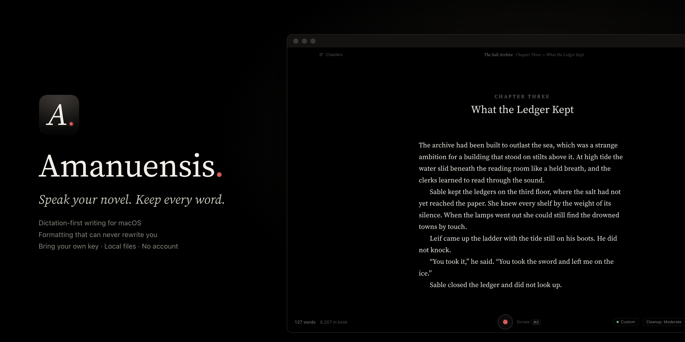
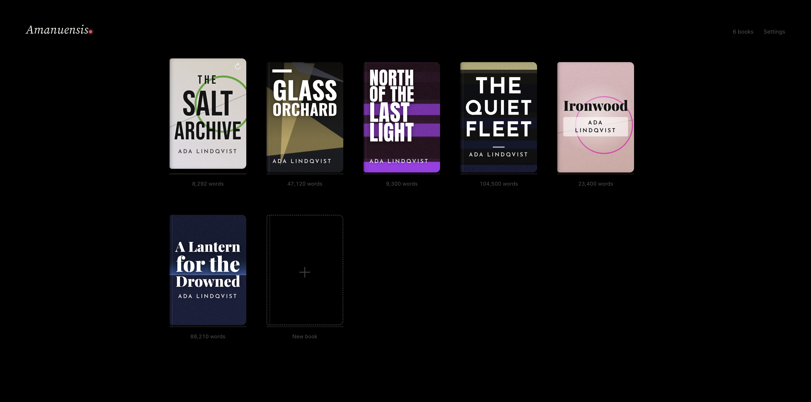
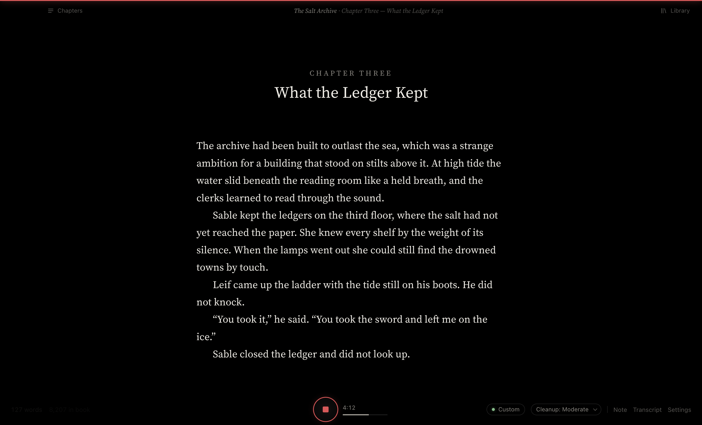
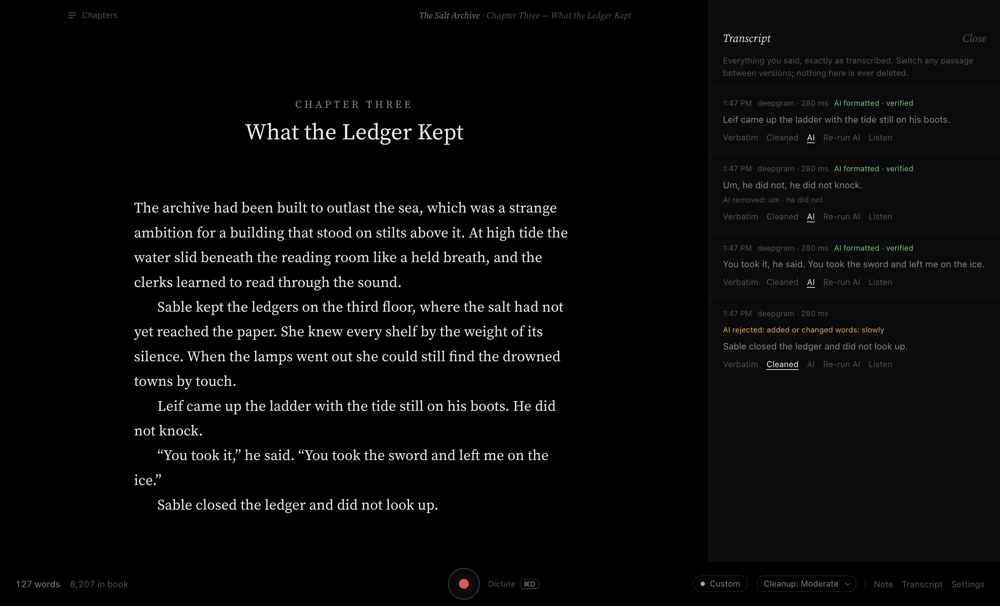
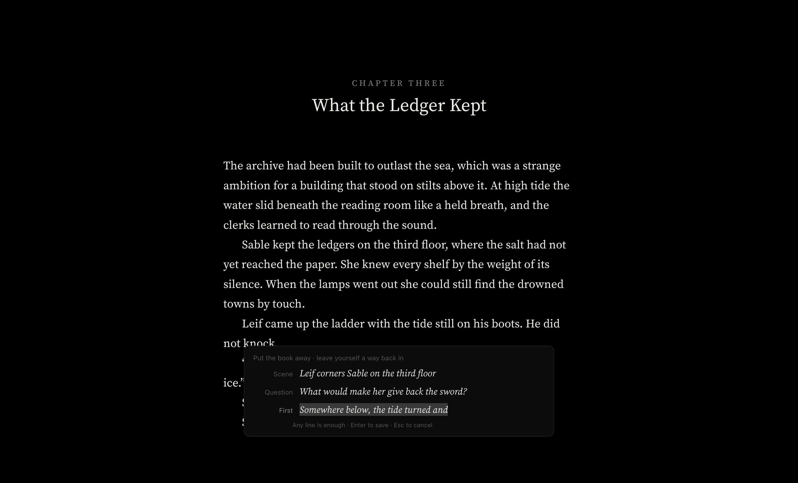
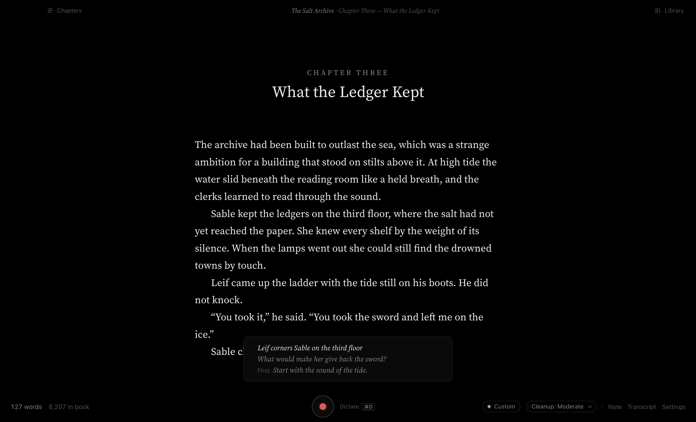

<p align="center"></p>

<p align="center">
  <a href="https://github.com/xavierschwindtwrites-ai/amanuensis/releases/latest"><b>Download for macOS (Apple Silicon)</b></a> ·
  <a href="https://xavierschwindtwrites-ai.github.io/amanuensis/">Website</a> ·
  <a href="#bring-your-own-api-key">Bring your own key</a> ·
  <a href="#the-one-rule">The one rule</a> ·
  <a href="#run-it">Build from source</a>
</p>

# Amanuensis

*An amanuensis is the scribe who writes down what an author dictates.*

A dictation-first writing app for novelists. Open a manuscript, press Record (⌘D), and talk. Your words appear on a black page as formatted manuscript prose: quotation marks, paragraphs and punctuation in place, and **never a word you didn't say**.

It's modeled on [NEO](https://github.com/hughhowey/neo): plain files, no accounts, controls that stay hidden until you reach for them.

## A look around

**Your books, as covers.** Every book gets a generated cover; don't like it, ask for another (↻), or export it at 3120 × 4500 as a placeholder cover.



**A black page and your voice.** Press ⌘D and talk. While you dictate, the counts fade away and only the recording controls stay.



**Every word accounted for.** The transcript keeps exactly what you said. AI cleanup may remove *um*s and false starts, and every change is checked word by word. Here the AI tried to add *slowly*, so it was rejected and the clean local version was used instead.



**A way back in.** When you stop, *Put the Book Away* (⇧⌘J) saves everything and asks for three optional lines: the scene you want to write, a question to find out, and the first thing you'll say. An unfinished sentence is offered as that first move. Next time, it's waiting above the Record button.

<p>
  
  
</p>

**Covers made from your titles**, set in real type by the same engine as NEO.


## Install

1. Download `Amanuensis-<version>-arm64.dmg` from [Releases](https://github.com/xavierschwindtwrites-ai/amanuensis/releases/latest) and drag Amanuensis to Applications.
2. The app isn't notarized by Apple yet, so the first time, **right-click it → Open → Open**. (Or run `xattr -dr com.apple.quarantine /Applications/Amanuensis.app`.)
3. Open Settings (⌘,), add a transcription key, and press ⌘D.

Apple Silicon Macs only for now.

## Bring your own API key

Amanuensis ships with **no API keys and no account**. Dictation and AI formatting use services you choose, with keys you supply:

| What | Services | You need |
|---|---|---|
| Transcription (required) | Groq, Deepgram, OpenAI, OpenRouter, or any OpenAI-compatible URL | A key from that service, or a local Whisper server (no key, nothing leaves your Mac) |
| AI formatting (optional) | OpenRouter, with the model you pick | An OpenRouter key. Without one, Amanuensis formats on your Mac. |

- **Where keys go:** paste them in Settings (⌘,). They're encrypted with your macOS Keychain and stored in the app's own settings folder, never in your library or in this repository.
- **Who sees your audio:** it goes straight from your Mac to the service you picked, and nowhere else. There's no Amanuensis server and no telemetry.
- **Who pays:** usage is billed by each provider to your own account.

## Run it

```
npm install
npm start
```

To build the Mac app (name, icon, Dock and menu all say Amanuensis):

```
npm run icon        # redraws build/icon.png
CSC_IDENTITY_AUTO_DISCOVERY=false npx electron-builder --mac dir --arm64
codesign --force --deep --sign - dist/mac-arm64/Amanuensis.app   # local ad-hoc signature
open dist/mac-arm64/Amanuensis.app
```

On first launch, open **Settings (⌘,)** and add a transcription key. For AI formatting, also add an OpenRouter key.

## The one rule

**The AI never rewrites your words.** Every AI result is checked word for word against the raw transcript before it reaches the page (`checkWords` in `lib/format.js`):

- The output's words must be the transcript's words, in the same order.
- It may delete only what your cleanup level allows:

| Level | May remove |
|---|---|
| Verbatim | nothing |
| Light | um, uh, er, hmm |
| Moderate | + doubled words ("the the"; never "had had") and false starts of up to 4 words |
| Aggressive | + longer restarts and "you know", "I mean", "like", "basically" |

Anything that adds, changes, or reorders a word is thrown out, and the local formatting stays. The Transcript (⇧⌘T) shows why.

Nothing is lost:

- The raw transcript of every passage is kept in `dictation/<chapter>.json`.
- Every passage can switch between **Verbatim**, **Cleaned**, and **AI** from the Transcript, or by right-clicking the text.
- Every recording session is saved as a WAV while you talk. A failed transcription can be retried from that audio, and **Listen** plays back any passage.
- Chapter snapshots are taken every 10 minutes and before any replacement. Right-click a chapter → **Earlier Versions…**

## Transcription services

| Service | Notes |
|---|---|
| Deepgram | True streaming. Words appear while you speak. |
| Groq Whisper | Fast and cheap. Text appears at each pause (default). |
| OpenAI | gpt-4o-transcribe / whisper-1 |
| OpenRouter | An audio-capable model such as Gemini |
| Custom | Any OpenAI-compatible URL, including the local server below |

**Local and private.** `tools/local_whisper_server.py` runs faster-whisper on this Mac, so nothing is uploaded:

```
pip install faster-whisper numpy
WHISPER_MODEL=large-v3 python3 tools/local_whisper_server.py
```

Then choose Custom with `http://127.0.0.1:8777/v1`.

**Names and terms** (Settings → This book) are sent to the transcriber as spelling hints.

## Speaking

- Just talk. A pause ends a passage; the pause length is adjustable.
- Say **"new paragraph"**, **"scene break"**, or **"new chapter"**.
- Spoken punctuation ("comma", "period", "quote … end quote") is off by default; turn it on in Settings.
- Words go where your cursor is. Click elsewhere while recording to move them.
- **File → Import Recording…** transcribes a voice memo (m4a, mp3, wav) into the chapter at the cursor.

## The shelf

Your books appear as covers, each generated from the book (abstract art plus real type for the title and author). Hover a cover and click **↻**, or right-click → New Cover, if you don't like it. The new cover is remembered. The cover generator is adapted from [NEO](https://github.com/hughhowey/neo) by Hugh Howey, used under the MIT License (`licenses/NEO-LICENSE.txt`); its typefaces are under the SIL Open Font License (`renderer/fonts/LICENSE-*.txt`).

To use a generated cover outside the app, right-click it → **Export Cover…**, or open the book and choose **File → Export → Book Cover (.png)…**. Amanuensis redraws the selected art, title and author into a **3120 × 4500 pixel PNG**, ready to use as a temporary cover.

## Coming back, and keeping going

These features live in `lib/habits.js`, separate from the manuscript pipeline. None of them touch your words.

- **Instant re-entry.** Amanuensis opens straight to the book and chapter you left, with the caret and scroll where they were. Each chapter remembers its own place. If text was added above, it finds your spot by the words just before it. It never turns on the microphone.
- **Notes for next time.** Press ⌘J, or click Note, and write what comes next ("Leif confronts Sable about the sword"). The note waits as a quiet line at the top of the page when you return. It hides while you dictate. Hover it to Edit, mark Done, or Delete. Notes are stored in `book.json`, never in chapter text. Optionally, in Settings → Sessions, a passage that *starts* with "note to self" becomes a note instead of manuscript. Its raw transcript stays in the Transcript.
- **A quiet line at the end of a session.** When you step away (5 minutes after typing, 45 seconds after a recording ends) or leave the book, one line at the bottom says what the session added, e.g. "Chapter Seven grew by 830 words." It needs at least 10 words added, and it disappears when you write again. There are no streaks, scores or dashboards. Sessions are logged in `book.json` and can be turned off in Settings.

## Put the book away

**File → Put the Book Away (⇧⌘J)** saves everything and offers a small card for next time, with three optional lines: the scene you want to write, a question you want to find out, and the first thing you'll say. If you stopped mid-sentence, that unfinished sentence is offered as the first move. Next time you open the book, the card is waiting above the Record button, and it retires itself once a session has written from it. It never stops a recording and never gets in the way of quitting. Cards live in `book.json`, never in your chapters.

## Writing Mastery (optional, off by default)

Sprints, goals and a private record of your writing sessions. Turn it on in Settings → Writing Mastery. The design and its research are in [`docs/writing-mastery-system.md`](docs/writing-mastery-system.md).

**Sprints**
- ⌥⌘S starts one, and finishes the one that's running. Click the sprint timer in the bottom bar to pause, resume, finish or discard.
- A sprint can hold any number of recordings, typing and thinking pauses.
- When the planned time passes, the timer counts on as overtime. It never stops a recording.
- A sprint pauses itself after 15 minutes away, and finishes itself after 5 idle minutes in overtime.
- If the app quits mid-sprint, the sprint comes back paused.

**Progress (⌥⌘P)**
- Net manuscript growth, kept apart from words dictated, typed, imported and removed in revision.
- Speaking time and estimated active composition time.
- Your typical sprint and speed, after 10 calibration sprints.
- Your daily goal, writing days, writing window and rest days, with an estimate of the sprints a day needs.

**Quiet feedback**
- One line after each sprint.
- A "Today" line before writing, on writing days with a goal.
- "today's goal reached" when it is.
- Nothing on rest days. An unmet goal is never mentioned.

**Training (⌥⌘D)**
- Exercises for five abilities: Mental Composition, Continuous Drafting, Dialogue Fluency, Scene Development and Writing Endurance.
- Each runs as a sprint in your current chapter, so your writing stays in your book.
- Afterwards you can say how it felt (Easy · About right · Hard), or dismiss the question.
- History shows what you practised, with factual measures from comparable sessions.
- Nothing is scored, and nothing advances automatically.

**Your data**
- Stored in `<Library>/.amanuensis/mastery/`, one file per Mac, so syncing never conflicts. Never in your manuscripts.
- Nothing is recorded while Writing Mastery is off.
- **Delete Writing Mastery data…** in Settings removes it all.
- The app never changes your goal.

## Writing

Enter starts a new paragraph. Typed quotes and `--` become curly quotes and em dashes. ⌘I for italic, ⇧⌘Enter for a scene break, ⌘F to find, ⌘N for a new chapter, ⌘J for a note for next time, ⌘= / ⌘- for text size, ⌘\ to pin the chapter list. Drag chapters to reorder them.

## Export

**File → Export** offers:

- Standard manuscript format .docx: title page, running header, chapters a third of the way down, `#` scene breaks.
- The same format as PDF.
- Markdown and plain text.
- The raw dictation transcript.

## Files

```
~/Documents/Amanuensis Library/<Book>/
  book.json  chapters/*.html  dictation/*.json  audio/*.wav  history/  trash/
```

API keys are encrypted with the macOS Keychain (Electron `safeStorage`) in the app's own settings, never in the library. Network calls happen in the main process; the window never sees a key.

## Tests

```
npm test                         # guard, formatter, audio, habits, Writing Mastery engine
test/fixtures/make-speech.sh /tmp/speech.wav      # synthesize the dictated test passage
AMANUENSIS_E2E_WAV=/tmp/speech.wav AMANUENSIS_E2E_STT=http://127.0.0.1:8777/v1 npx electron test/e2e.js
AMANUENSIS_E2E_WAV=speech.wav AMANUENSIS_E2E_STT=http://127.0.0.1:8777/v1 npx electron test/e2e-mastery.js
npx electron test/e2e-scene.js      # Put the Book Away and the scene card
npx electron test/e2e-library.js    # the shelf, covers, cover export, quiet numbers
npx electron test/e2e-apprentice.js # Training
npm run screenshots                 # regenerate docs/images from a staged demo library
```

The end-to-end test plays real speech into the app's microphone path and drives the UI. It transcribes with the local Whisper server and formats with a mock formatter that tries to slip in an extra word.

## License

[MIT](LICENSE) © 2026 Xavier Schwindt. The cover generator (from NEO) is MIT-licensed, and the bundled fonts are under the SIL Open Font License; see `licenses/NEO-LICENSE.txt` and `renderer/fonts/LICENSE-*.txt`.
